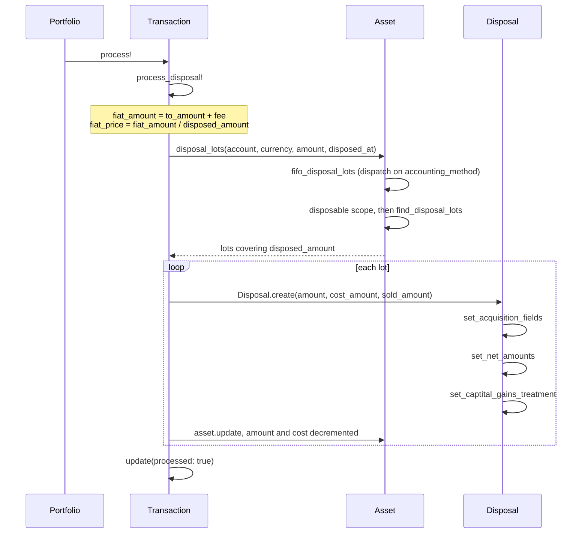
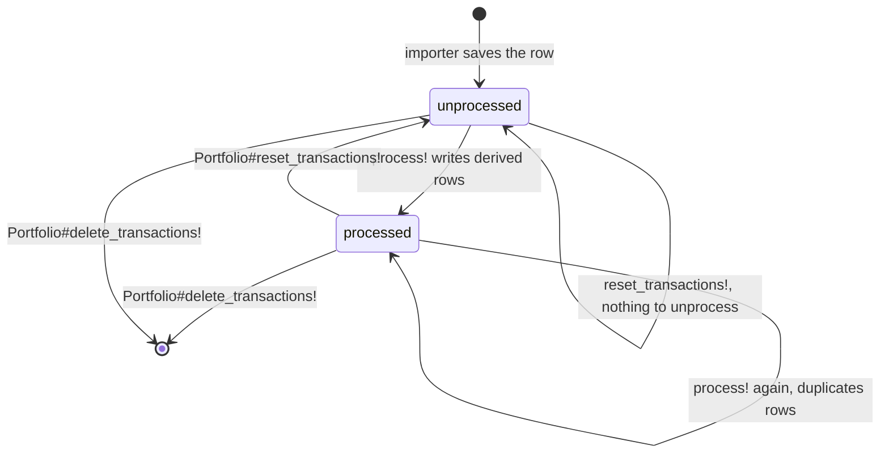

# Accounting engine

How rows in `transactions` become cost-basis lots, sales, and transfers. This
assumes the table shapes in [the data model](data-model.md) and the pipeline steps
in [the workflow](workflow.md).

All of it runs from `Transaction#process!` (`models/transaction.rb:110`). Importers
only build unsaved `Transaction` rows; no accounting happens at import time.

## The dispatch table

`process!` is a `case` on the `transaction_type` enum. Each branch runs one or more
private processors, then `update(processed: true)`.

Processor, in `models/transaction.rb`, and the rows each type writes.

| `type` | Processor | Rows written |
| --- | --- | --- |
| `buy`, `interest`, `reward`, `refund` | `process_acquisition!` :209 | `Acquisition` -> `Asset` |
| `sell` | `process_disposal!` :257 | `Disposal` per lot, lots decremented |
| `exchange` | `process_disposal!` :257, then `process_acquisition!` :209 | `Disposal` + `Acquisition` -> `Asset` |
| `loss_bankruptcy_liquidation` | `process_loss_bankruptcy_liquidation!` :238 | `Disposal`, optional `Acquisition` |
| `transfer_out` | `process_transfer_out!` :322 | `Transfer` -> `TransferredAsset` + `Asset` |
| `transfer_in` | `process_transfer_in!` :351 | same, from the receiving side |

Types outside the list are silently ignored. `income`, `airdrop`, `staking`,
`mining`, `fork`, `gift_received`, `gift_sent`, `payment`, `fee`,
`loss_investment`, `loss_theft`, `loss_casualty`, and `loss_bankruptcy` exist in the
enum (`migrate/007_transactions.rb:5-31`) and fall through the `case`. They write
nothing and never set `processed`, so they stay in `unprocessed_transactions`
permanently.

`process!` is not idempotent: running it twice on one transaction writes a second
set of derived rows. The pipeline avoids that by iterating
`Portfolio#unprocessed_transactions` (`models/portfolio.rb:27`, a
`where(processed: false)` association) from `Portfolio#process_transactions!`
(`models/portfolio.rb:50`). To recompute, call `Portfolio#reset_transactions!`
(`models/portfolio.rb:54`), which deletes acquisitions, assets, disposals,
transfers, and transferred assets, then flips every transaction back to
`processed: false` with a raw dataset update. Order matters: that association is
ordered `completed_at, type`, so earlier events run first and lots exist by the time
a disposal needs them.

## From acquisition to lot

`Acquisition#before_save` runs `set_average_cost_amount`
(`models/acquisition.rb:89`), which derives `average_cost_amount = cost_amount /
amount` when that field is nil, `cost_amount` is present, and `amount` is positive.
It never overwrites a value set explicitly. `Acquisition#after_create` then runs
`create_asset` (`models/acquisition.rb:71`), writing exactly one `Asset` lot per
acquisition. The lot copies `currency`, `amount`, `cost_currency`, `cost_amount`,
`average_cost_amount`, `type`, and `acquired_at`, and seeds the account-level
columns from the same values: `account_cost_amount: cost_amount`,
`account_average_cost_amount: average_cost_amount`, `account_acquired_at:
acquired_at`. Those pairs diverge only when a transfer rewrites the account columns.
`assets.acquisition_id` is `NOT NULL`, so every lot traces to one acquisition.

`process_acquisition!` (`models/transaction.rb:209`) picks the cost basis:

- Crypto in from crypto (`exchange`, `interest`, `reward`): cost is `market_value`
  in `market_value_currency`, plus a fee grossed up to the same units,
  `cost_amount += (market_value / from_amount.abs) * fee.abs`.
- Fiat in (`buy`): cost is `from_amount.abs` plus `fee.abs`, since the fee is
  already denominated in the fiat currency.
- It returns early when `type == 'exchange' && market_value.nil?`, so an exchange
  with no price data creates no lot, and when `from_amount.zero?`.

## How a sale consumes lots

`process_disposal!` takes `disposed_amount`, defaulting to `from_amount.abs`
(`models/transaction.rb:257`). The first block reduces the transaction to a fiat
proceeds figure, and the two shapes differ. For `sell`, `to_currency` is fiat, so
`fiat_currency = to_currency` and `fiat_amount = to_amount + (fee || 0)`. Gemini
writes sell fees as negative fiat, so adding the fee lowers proceeds.

For `exchange`, `to_currency` is crypto and the fiat leg only exists in
`market_value`. So `fiat_currency = market_value_currency` and `fiat_amount =
market_value`, which excludes the fee, and the fee is denominated in the crypto being
disposed:

```ruby
fee_amount = fee.abs
fiat_amount += (market_value / disposed_amount) * fee_amount
disposed_amount += fee_amount # fee is also being disposed
```

`fiat_price = fiat_amount / disposed_amount` (`:280`) is then a uniform per-unit
proceeds figure applied to every lot.

`Asset.disposal_lots` returns the lots to consume and the loop writes one `Disposal`
per lot. A full-lot consumption copies the lot's `cost_amount` and
`account_cost_amount` and decrements `disposed_amount`. A partial consumption (`:291`)
prorates by average cost:

```ruby
amount              = disposed_amount.abs
cost_amount         = amount * asset.average_cost_amount
account_cost_amount = amount * asset.account_average_cost_amount
```

With `sold_amount = fiat_price * amount`, the lot is updated in place (`:314`) by
subtracting the consumed `amount`, `cost_amount`, and `account_cost_amount`. Lots are
never deleted; a fully consumed lot keeps its acquisition link at `amount` zero.

Worked example with invented figures, not real trades. Sell 0.5 BTC at $20,000 with a
-$10 fee, so `to_amount` is 10000, `fiat_amount = 10000 + (-10) = 9990`, and
`fiat_price = 9990 / 0.5 = 19980`. Two lots exist: 0.3 BTC at `average_cost_amount`
12000, and 0.4 BTC at 15000.

| Lot | branch | amount | cost_amount | sold_amount | net_amount |
| --- | --- | --- | --- | --- | --- |
| 1 | full | 0.5 -> 0.3 | 0.3 x 12000 = 3600 | 0.3 x 19980 = 5994 | 2394 |
| 2 | partial | 0.4 -> 0.2 | 0.2 x 15000 = 3000 | 0.2 x 19980 = 3996 | 996 |

Lot 1 is consumed whole, `disposed_amount` drops from 0.5 to 0.2, and lot 2 takes the
partial branch. Lot 2's remaining row keeps `amount` 0.2 and `cost_amount` 3000, so
its average cost is unchanged.

## Lot selection

`Asset.disposal_lots` (`models/asset.rb:52`) dispatches with `send` on
`"#{account.accounting_method}_disposal_lots"`. `accounts.accounting_method` is a
Postgres enum of `fifo`, `lifo`, `hifo`, `spec` (`migrate/003_accounts.rb:5-13`),
defaulting to `fifo`. There is no `spec_disposal_lots`, so an account set to `spec`
raises `NoMethodError` on its first disposal.

All three methods start from `Asset.disposable` (`models/asset.rb:85`), which filters
to `amount > 0` and `acquired_at <= disposed_at` for one account and currency. That
is the cutoff rule: a lot acquired after the disposal cannot be used. They differ
only in ordering, and each passes `find_disposal_lots` (`models/asset.rb:93`) a block
that continues from the chosen lot:

- `fifo_disposal_lots` orders `(:acquired_at, :id)`, continues `acquired_at >= lot.acquired_at`.
- `lifo_disposal_lots` reverses both, continues `acquired_at <= lot.acquired_at`.
- `hifo_disposal_lots` orders `reverse(:average_cost_amount, :acquired_at, :id)`,
  continues `average_cost_amount <= lot.average_cost_amount`.

`find_disposal_lots` takes the first lot, subtracts its amount, and loops while the
remainder is positive. Each iteration re-queries from the picked lot's position and
excludes already-picked ids, so ties resolve on the `:id` tiebreaker. It stops as soon
as the remainder is zero or negative, and returns fewer lots than requested when the
supply runs out. HIFO's descending `acquired_at` means equal-cost lots are consumed
newest-first, which is LIFO inside a cost tier.

## Disposal math and holding period

`Disposal#before_validation` (`models/disposal.rb:76`) runs three setters.
`set_acquisition_fields` (`:137`) backfills `acquisition_type` and `acquired_at` from
the linked acquisition, which is what lets the original purchase date survive a
transfer. `set_net_amounts` (`:121`) computes `net_amount = sold_amount - cost_amount`
and `account_net_amount = sold_amount - account_cost_amount`. The pair exists because
a transferred lot carries two cost bases: the original one from the account that
bought it, and the fair-market value recorded on the receiving account.

`set_captital_gains_treatment` (`:128`) classifies by day count against
`LONG_TERM_GAIN_DAYS = 366` (`models/disposal.rb:74`). Under 366 days is
`short_term`, otherwise `long_term`. It sets `capital_gains_treatment` from
`acquired_at` and `account_capital_gains_treatment` from `account_acquired_at`. The
method name is misspelled, `captital`; grep the misspelling to find it. `Disposal`
also extends `Txf::Form8949` (`models/disposal.rb:70`) to emit TurboTax rows.

## Transfers

A transfer is two transactions on two accounts that must be matched into one `Transfer`
row, and either side can trigger the match.

`process_transfer_out!` (`models/transaction.rb:322`) looks for an existing `Transfer`
first and returns it, so the second side processed reuses the row. Otherwise it calls
`Transaction.matching_transfer_in` (`:74`), which requires `type == 'transfer_in'`, the
same `portfolio_id`, the same `to_currency_id` on both legs, `processed: false`, a
*different* `account_id`, and `completed_at` within `MAX_TRANSFER_DELTA_SECS`
(`models/transaction.rb:70`), which is 3 days. The amount predicate is
`to_amount: -(transaction.to_amount - (transaction.fee || 0))`. Both legs store the
crypto amount in `to_amount`, the out leg negative, so the fee is added back to the
smaller in-leg amount. `matching_transfer_out` (`:82`) runs the mirror query as SQL:
`(-to_amount + coalesce(fee, 0)) = ?`.

Zero matches raises with the account name, currency, amount, and timestamp; more than
one raises with the count. These are the most common pipeline failures, and the fix is
usually a fee adjustment in the importer, not a wider window.
`importers/voyager_custom.rb:123` shows that fix: `parse_withdraw_fee!` adds the
withdrawn fee back into `to_amount` so the legs match. Once matched, `Transfer.create`
records `amount` as the net crypto that arrived (`to_amount.abs + (fee || 0)` from the
out side, plain `to_amount` from the in side), plus `fiat_currency`,
`account_cost_amount` from the receiving transaction's `market_value`, and both
timestamps.

### Moving the lots

`Transfer#before_create` calls `set_account_average_cost!` (`models/transfer.rb:166`),
whose guard is `account_cost_amount.nil? && account_cost_amount`. That can never be
true, so the method never assigns. The dead code is left in place.

`Transfer#after_create` calls `transfer_assets!` (`models/transfer.rb:98`). It reads
the fee off the from-transaction, then:

```ruby
fee = (from_transaction.fee || 0).abs
transferred_amount = amount + fee
fee_rate = fee / transferred_amount
```

`transferred_amount` is the gross amount that left the source account, so
`Asset.disposal_lots` selects against it using the source account's accounting method.
The loop mirrors `process_disposal!`: full lots copy their cost, partial lots prorate
by `average_cost_amount` and `account_average_cost_amount`. The fee is prorated per lot
by `amount_after_fee = amount * (1 - fee_rate)`. Cost is not prorated, so the full
`cost_amount` travels with the lot and the fee raises the receiving account's effective
cost per unit.

Two rows are written per lot. A `TransferredAsset` (`models/transfer.rb:121`) is the
audit record of the move, carrying `from_account`, `to_account`, `transfer`, the
acquisition link, `amount_after_fee`, and the copied cost fields. A new `Asset` (`:138`)
is the receiving lot: it lands on `to_account` with `amount: amount_after_fee`, keeps
the source lot's `cost_amount`, `average_cost_amount`, `acquired_at`, and
`account_acquired_at`, and sets `transferred_in_at: to_completed_at`. Finally the source
lot is decremented by the gross `amount` and its cost columns (`:155`), and the transfer
is updated with `cost_amount: total_cost` and `average_cost_amount: total_cost / amount`
(`:163`), the latter divided by the net amount.

### Two acquisition timestamps

`acquired_at` is the original purchase date, copied verbatim across every hop. It drives
`capital_gains_treatment`, so a coin bought three years ago and transferred last month
is still long-term. `account_acquired_at` is when the asset arrived on the account
holding it. For a directly purchased lot `Acquisition#create_asset` sets it equal to
`acquired_at`, and `transfer_assets!` copies it rather than resetting it, so
`account_capital_gains_treatment` tracks the same clock.

`account_cost_amount` is the fair-market value at transfer-in, taken from the receiving
transaction's `market_value` in `process_transfer_in!` (`models/transaction.rb:351`). It
answers "what did this cost me on this account," which is the figure a custodian's own
1099 reports, and `account_net_amount` is the gain measured against it.

## Losses from bankruptcy liquidation

`process_loss_bankruptcy_liquidation!` (`models/transaction.rb:238`) handles platform
collapses where part of a balance is recovered. It ignores the transaction's own
`from_amount` and disposes the entire remaining position:

```ruby
total_amount = Asset.disposable_amount(account:, currency: from_currency, disposed_at: completed_at)
process_disposal!(total_amount) # claim loss on all from_currency assets
```

`Asset.disposable_amount` (`models/asset.rb:80`) is the `disposable` scope grouped and
summed, returning `0` when nothing matches. Disposing everything books the loss against
the full accumulated cost basis. If `to_currency` is crypto (an in-kind recovery, e.g. a
stablecoin) the method continues and creates an `Acquisition` with `type: 'exchange'`
and `cost_amount: market_value`, with no fee adjustment, on the assumption that the
recovered asset's basis equals its value on arrival. When `to_currency` is fiat it
returns after the disposal.

## Diagrams

One `sell`, end to end.



The `processed` flag across a pipeline run.



## Money is BigDecimal

Importers parse every amount with `BigDecimal`, for instance `importers/voyager.rb:93`
and `importers/gemini.rb:55`. The columns are `numeric` (`BigDecimal` in the migrations,
visible in the schema comment atop each model file), so no float rounding enters the
accounting path. Division of two `BigDecimal`s is exact to the working precision, which
is why `fiat_price`, `fee_rate`, and `average_cost_amount` are stored unrounded and
rounded only at render time. Every `table_row` calls `.to_s('F')` to force fixed
notation so a small value never prints as `0.1e-5`; see `models/transaction.rb:187`,
`models/disposal.rb:95`, and `models/transferred_asset.rb:62`. Report code should follow
that pattern.
