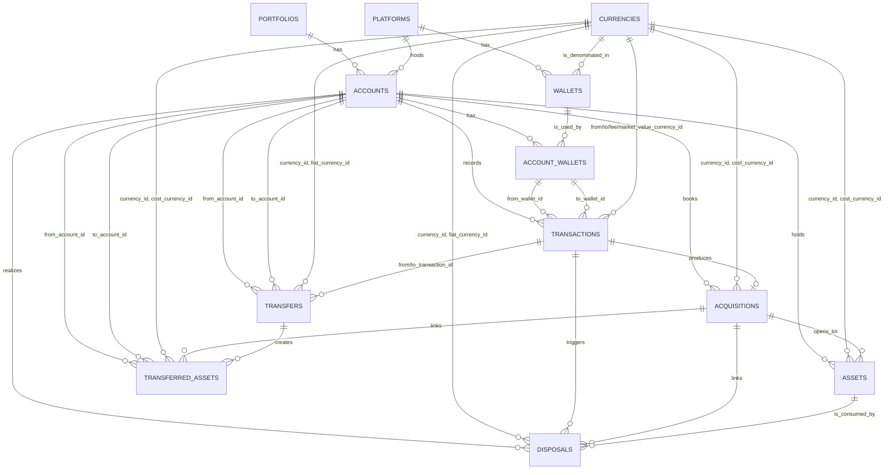

# Data model

Reference for the PostgreSQL schema: twelve tables, six enum types, and the
constraints that shape the import and accounting pipeline. Every claim comes from
`migrate/*.rb`, `models/*.rb`, and the annotated schema comment at the top of each
model file. See [the processing workflow](workflow.md) for how rows get written and
[accounting](accounting.md) for how cost basis is computed.

## Diagram

The reference tables (`platforms`, `currencies`, `wallets`, `account_wallets`)
describe the world. The accounting chain
(`portfolios` -> `accounts` -> `transactions` -> `acquisitions` -> `assets` ->
`disposals` / `transfers` -> `transferred_assets`) is derived from it. Where a table
has several foreign keys to one target, the label is the column name.

`TRANSACTIONS ||--o| ACQUISITIONS` is one-to-zero-or-one because
`acquisitions.transaction_id` is unique (`migrate/008_acquisitions.rb:23`).
`ASSETS ||--o{ DISPOSALS` is not a database relationship; it is the lot-consumption
edge that `Transaction#process_disposal!` walks (`models/transaction.rb:282,310`).
`portfolio_id` is denormalized onto `transactions`, `assets`, `disposals`, `transfers`,
and `transferred_assets` (`models/portfolio.rb:16-22`), which is why the diagram routes
those tables through `accounts`.

## Tables

### portfolios

The top-level container: `name`, `created_at`, `updated_at` (`migrate/001_portfolios.rb`).
`Portfolio#reset_transactions!` (`models/portfolio.rb:52`) and `#delete_transactions!`
(`models/portfolio.rb:57`) cascade over the denormalized keys: transfers, transferred
assets, disposals, assets, acquisitions, then either unprocessing or deleting
transactions.

### platforms

Exchanges and custodians, unique on `name` (`migrate/002_platforms.rb:7`). `Platform`
uses the Sequel `static_cache` plugin and builds `BY_NAME` at load
(`models/platform.rb:20-24`), so `.by_name` is a hash lookup and new rows need
`Platform.load_cache`. Treat it as read-only. `seed.rb:24-36` lists the nine seeded
platforms.

### currencies

`name` is the full name, `symbol` the ticker, `type` the `currency_type` enum. The
unique index is the triple `(symbol, name, type)` (`migrate/004_currencies.rb:14`),
which permits one symbol under two types. `Currency.by_symbol`
(`models/currency.rb:50`) resolves by symbol, then optionally narrows with `name:`. Its
`type:` filter compares `c.name` against `"crypto"`/`"fiat"` (`models/currency.rb:59-60`),
so it never matches and the argument is inert. `#fiat?` and `#crypto?` compare `type`
correctly (`models/currency.rb:67-72`).

### accounts

A portfolio's presence on one platform. `portfolio_id` and `platform_id` are NOT NULL,
`accounting_method` is the enum of the same name defaulting to `fifo`, and `started_on`
is the earliest date the account's history covers (`migrate/003_accounts.rb`).
`platform_account_id` is free-form; nothing in `models/` reads it. Three composite
indexes cover `(portfolio_id, platform_id)` with `name` and with `platform_account_id`
(`migrate/003_accounts.rb:26-28`), none unique, so duplicate account rows are possible.

`accounting_method` is the lot-selection dispatch key: `Asset.disposal_lots` calls
`send("#{account.accounting_method}_disposal_lots", ...)` (`models/asset.rb:52-54`).
Only `fifo`, `lifo`, and `hifo` have methods, so an account set to `spec` raises
`NoMethodError` on the first disposal. `Account#reset_transactions!`
(`models/account.rb:47`) is the per-account version of the portfolio reset;
`#delete_transactions!` (`models/account.rb:57`) is what the per-platform import scripts
call.

### wallets

A chain address scoped to a platform and a currency, unique on
`(platform_id, currency_id, address)` (`migrate/005_wallets.rb:13`). No model code reads
wallets; `models/wallet.rb` declares only `one_to_one :platform` and
`one_to_one :currency`. The table records address-level provenance.

### account_wallets

Join table between accounts and wallets, unique on `(account_id, wallet_id)`
(`migrate/006_account_wallets.rb:10`). It has its own primary key because
`transactions.from_wallet_id` and `to_wallet_id` reference `account_wallets(id)` rather
than `wallets(id)` (`migrate/007_transactions.rb:39-40`): a wallet endpoint identifies an
account/wallet pairing, not a bare address. `Transaction` declares
`many_to_one :from_wallet, class: :Wallet` (`models/transaction.rb:58-59`), so the
association loads a `Wallet` whose key does not match the FK. Nothing in the pipeline
uses those associations.

### transactions

The normalized input table: one row per platform event, written by the importers and
consumed by `Transaction#process!` (`models/transaction.rb:110`). `account_id` and
denormalized `portfolio_id` are NOT NULL, as are `from_currency_id` and `to_currency_id`;
`fee_currency_id` and `market_value_currency_id` are nullable. `from_amount`,
`to_amount`, `market_value`, and `fee` are `BigDecimal`, and sign carries direction:
`#set_amount!` puts a negative amount in `from_amount` and a positive one in `to_amount`
(`models/transaction.rb:165`). `type` is the `transaction_type` enum, `processed` a
boolean default false, and `completed_at` the platform timestamp that orders all lot math.

`#classify_trade` (`models/transaction.rb:176`) maps signed currency pairs to `buy`,
`sell`, or `exchange`. `process!` handles `buy`, `interest`, `reward`, `refund`, `sell`,
`exchange`, `loss_bankruptcy_liquidation`, `transfer_in`, and `transfer_out`; every other
type is skipped and stays `processed: false`.

The transfer matcher is the most index-sensitive query here.
`Transaction.matching_transfers` (`models/transaction.rb:91`) filters on `portfolio_id`,
`type`, `from_currency_id`, `to_currency_id`, `processed`, and `completed_at` in a
window, and excludes the same `account_id`. The window is `MAX_TRANSFER_DELTA_SECS`,
three days either side (`models/transaction.rb:70`). Zero matches or more than one raises
(`models/transaction.rb:334-337`).

### acquisitions

One row per cost-basis-creating event, written by `process_acquisition!`
(`models/transaction.rb:209`). `transaction_id` is unique, so an acquisition is the 1:0..1
accounting product of a transaction. There is no `portfolio_id`; `Acquisition` reaches
the portfolio through `account`. `amount` is denominated in `currency_id`, `cost_amount`
in `cost_currency_id`. `average_cost_amount` is derived in `before_save` as
`cost_amount / amount` when nil (`models/acquisition.rb:89-93`), and `after_create` opens
the matching lot with `create_asset` (`models/acquisition.rb:48-50,71-87`).

### assets

The lot table: one row per `(account, currency, acquisition)` position, decremented as it
is disposed or transferred. `acquisition_id` is NOT NULL and `type` reuses the
`acquisition_type` enum (`migrate/009_assets.rb:11-12`). `acquired_at` is the original
acquisition time and is copied across transfers, so it is the true holding-period start.
`account_acquired_at` is when the current account got the lot, and `transferred_in_at` is
set only on lots created by a transfer (`models/transfer.rb:150`). A lot is consumed by
driving `amount` to zero; the accounting path never deletes rows. `Asset.disposable`
filters `amount > 0` (`models/asset.rb:85-89`), and the report scripts repeat the
condition when listing open positions.

### disposals

One row per (transaction, lot) pair produced by a disposal. `transaction_id` is nullable
(`migrate/010_disposals.rb:29`) because a disposal is a child of a transaction, so the
one-to-many needs no unique key. `acquisition_id` is NOT NULL and points at the lot's
origin, which is how a disposal reports the original acquisition date and type:
`set_acquisition_fields` copies `acquisition.type` and `acquisition.acquired_at`
(`models/disposal.rb:137-142`). `amount` is the crypto disposed; `cost_amount` and
`sold_amount` are fiat; `net_amount` is `sold_amount - cost_amount`, computed in
`before_validation` (`models/disposal.rb:121-126`). `capital_gains_treatment` comes from
`disposed_on - acquired_on` against `LONG_TERM_GAIN_DAYS = 366`
(`models/disposal.rb:74,128-135`). `Disposal` extends `Txf::Form8949`
(`models/disposal.rb:66`).

### transfers

A matched `transfer_out` / `transfer_in` pair. `from_transaction_id` and
`to_transaction_id` are nullable FKs to `transactions` (`migrate/011_transfers.rb:10-11`),
`from_account_id` and `to_account_id` are separate FKs to `accounts`, and
`from_completed_at` and `to_completed_at` record both legs.

`Transfer.create` is where the lot math happens. `before_create` calls
`set_account_average_cost!` (`models/transfer.rb:166-170`), whose guard
`account_cost_amount.nil? && account_cost_amount` can never be true, so
`account_average_cost_amount` is never assigned there. `after_create` runs
`transfer_assets!` (`models/transfer.rb:98`), which selects lots from the sending
account, writes `transferred_assets` rows, creates the receiving account's `assets`
rows, decrements the source lots, and finally writes `cost_amount` and
`average_cost_amount` back onto the transfer (`models/transfer.rb:163`).

### transferred_assets

The audit record of what each transfer moved, one row per (transfer, source lot).
`transfer_id` and `acquisition_id` are NOT NULL, so a transferred asset keeps the
original acquisition lineage alongside the `from_account_id` / `to_account_id` pair
(`migrate/012_transferred_assets.rb:9-13`). `amount` is post-fee: `transfer_assets!`
computes `amount_after_fee = amount * (1 - fee_rate)` and writes that to both the
transferred asset and the new lot (`models/transfer.rb:119,126,144`). The rows are
append-only; nothing reads them back into the accounting path, and the report
scripts render them directly.

## Enum types

All six are created by `create_enum` in migrations, not in Ruby. Adding a value requires
a new migration; the models validate against the DB type, so an unrecognized string
raises at insert.

- `transaction_type` (`migrate/007_transactions.rb:5-31`): `transfer_out`,
  `transfer_in`, `buy`, `sell`, `exchange`, `refund`, `income`, `interest`, `reward`,
  `airdrop`, `staking`, `mining`, `fork`, `gift_received`, `gift_sent`, `payment`, `fee`,
  `loss_investment`, `loss_theft`, `loss_casualty`, `loss_bankruptcy`,
  `loss_bankruptcy_liquidation`.
- `acquisition_type` (`migrate/008_acquisitions.rb:5-20`): `buy`, `exchange`, `refund`,
  `income`, `interest`, `reward`, `airdrop`, `staking`, `mining`, `fork`,
  `gift_received`.
- `disposal_type` (`migrate/010_disposals.rb:5-19`): `sell`, `exchange`, `gift_sent`,
  `payment`, `fee`, `loss_investment`, `loss_theft`, `loss_casualty`, `loss_bankruptcy`,
  `loss_bankruptcy_liquidation`.
- `capital_gains_treatment` (`migrate/010_disposals.rb:21`): `short_term`, `long_term`.
- `accounting_method` (`migrate/003_accounts.rb:5-13`): `fifo`, `lifo`, `hifo`, `spec`.
- `currency_type` (`migrate/004_currencies.rb:5`): `crypto`, `fiat`.

The first three overlap by design. `Transaction#process_disposal!` passes `type:`
straight into `Disposal.create` (`models/transaction.rb:305`), so any value reaching the
disposal branch must also exist in `disposal_type`. `loss_bankruptcy` is in
`transaction_type` but has no `process!` branch, so it is never written. `assets.type`
and `disposals.acquisition_type` reuse `acquisition_type` to carry the lot's origin kind
forward.

## Two tiers of cost

`assets`, `disposals`, and `transfers` each carry a plain cost pair and an `account_*`
pair. The distinction is whose clock and whose basis the row answers.

The plain columns track the original acquisition. `cost_amount` and
`average_cost_amount` come from the `Acquisition` that opened the lot, and `acquired_at`
is that acquisition's timestamp. They survive transfers unchanged: `transfer_assets!`
copies `cost_amount`, `average_cost_amount`, and `acquired_at` from the source lot onto
both the `TransferredAsset` and the new `Asset` (`models/transfer.rb:122-148`).

The `account_*` columns track cost as the receiving account recorded it.
`Acquisition#create_asset` seeds `account_cost_amount: cost_amount`,
`account_average_cost_amount: average_cost_amount`, and
`account_acquired_at: acquired_at` (`models/acquisition.rb:71-86`), so for a lot that
never moved the two tiers are identical. They diverge when a transfer carries a market
value: `process_transfer_out!` and `process_transfer_in!` set `account_cost_amount` on
the `Transfer` from the transfer transaction's `market_value`
(`models/transaction.rb:344,372`), and `transfer_assets!` writes that tier onto the
receiving lot. `account_acquired_at` is the receiving account's date, and
`Disposal#set_captital_gains_treatment` uses it for `account_capital_gains_treatment`
(`models/disposal.rb:131-134`).

Two tiers, two reports. The TurboTax export uses the original tier: `lib/txf.rb:43,47,49`
read `capital_gains_treatment`, `acquired_at`, and `cost_amount`. The `account_*` tier is
what a custodian's own 1099-B would show, since a receiving exchange reports the basis
and date it was given.

Partial consumption prorates each tier independently. In `process_disposal!` a full-lot
disposal takes `asset.cost_amount` and `asset.account_cost_amount` verbatim; a partial
takes `amount * asset.average_cost_amount` and
`amount * asset.account_average_cost_amount` (`models/transaction.rb:285-295`).
`transfer_assets!` does the same, guarding the account tier with
`if asset.account_average_cost_amount` (`models/transfer.rb:110-117`). The guard matters
because `account_cost_amount` and `account_average_cost_amount` are nullable with a 0
default on `assets`, `transfers`, and `transferred_assets` (`migrate/009_assets.rb:16-17`).

## Composite indexes

The indexes are wide on purpose. The two hot paths are lot selection during processing
and date-range reporting, and both filter on a fixed prefix of equality columns followed
by range columns.

`Asset.disposable` is the filter every accounting method starts from:
`where(account_id:, currency_id:)` plus `amount > 0 and acquired_at <= disposed_at`
(`models/asset.rb:85-89`). That is an equality prefix on `(account_id, currency_id)` and a
range on `acquired_at`, which is the shape of
`assets_portfolio_id_account_id_currency_id_acquired_at_amount_index`
(`migrate/009_assets.rb:26`). The trailing `amount` lets Postgres evaluate `amount > 0`
from the index. Sibling indexes add `average_cost_amount` and `account_acquired_at` so the
`hifo` ordering (`models/asset.rb:72-78`) and the transfer-era lookups stay
index-supported. `portfolio_id` leads each one because reports query whole portfolios.

`disposals` carries ten composite indexes in two mirrored sets: five led by
`portfolio_id, account_id` and five by `portfolio_id` alone
(`migrate/010_disposals.rb:48-58`). Each set varies the third column across
`capital_gains_treatment`, `type`, and `currency_id`, always followed by
`disposed_at, acquired_at`. That covers reports grouping gains by tax treatment and
disposal type over a date range, at account and portfolio level.

`transfers` and `transferred_assets` index each side of the pair separately, because a
transfer is looked up from the sender (`from_account_id`, `from_completed_at`) and from
the receiver (`to_account_id`, `to_completed_at`), with currency as an optional middle
column (`migrate/011_transfers.rb:29-37`, `migrate/012_transferred_assets.rb:29-36`).

`transactions` has the densest set. `account_id, processed, completed_at, type` and
`account_id, processed, type, completed_at` (`migrate/007_transactions.rb:67-68`) serve
the processing queue: `Portfolio#unprocessed_transactions` selects `processed: false`
ordered by `completed_at, type` (`models/portfolio.rb:26-28`). The transfer matcher needs
`portfolio_id, completed_at, type` (`migrate/007_transactions.rb:63`) plus the currency
pairs at `migrate/007_transactions.rb:70-74`. The cost is write amplification: eight
indexes on `assets` and thirteen on `transactions` all update during a bulk import. The
pipeline runs as batch jobs, so reads win.

## Transaction uniqueness

`unique %i[account_id type platform_transaction_id]`
(`migrate/007_transactions.rb:62`) is the dedup key, enforced by a unique btree visible as
`transactions_account_id_type_platform_transaction_id_key` in the annotation at
`models/transaction.rb:26`. Three consequences for re-imports.

A `platform_transaction_id` only has to be unique within an `(account, type)` pair. The
same id can appear under two accounts, and the same id can appear twice in one account as
a `buy` and a `fee`. Import scripts exploit the first fact:
`importers/coinbase_pro.rb:109` prefixes the id with `@account.id`.

Re-importing a file is a no-op only if the ids are stable. Importers synthesize ids from
type, timestamp, currency, and amount when the platform supplies nothing durable, for
example `"#{row[TYPE]}:#{completed_at.to_i}:#{row[CURRENCY]}:#{row[AMOUNT]}"` at
`importers/blockfi.rb:232`. If a re-export shifts a timestamp or rounds an amount
differently, the synthetic id changes and the row inserts as a duplicate rather than
colliding.

Duplicates surface as `Sequel::ValidationFailed` on save, which is why every import script
wraps `save_changes` in a rescue that counts the failure. Keep that pattern; the import is
not transactional per row, so a script that dies on the exception leaves the rows saved
before it in place.

`acquisitions.transaction_id` is unique for the matching reason at the accounting layer:
one transaction produces at most one acquisition, so reprocessing after
`Portfolio#reset_transactions!` cannot double-book a lot. See
[the processing workflow](workflow.md) for the reset sequence.
