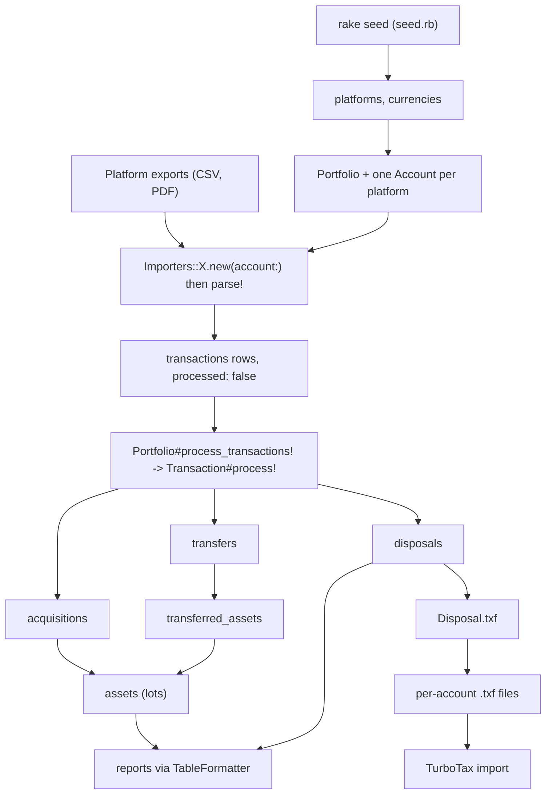

# Workflow

The pipeline for one tax year: export files from each platform, load them,
process them into cost-basis lots, read the reports, write TurboTax files.

This page describes the stages and the library calls that implement them. There
is no CLI yet, so each stage is a Ruby script you write against the importers and
models. Where a step below shows code, treat it as the shape to implement.

Related: [the data model](data-model.md) for tables and columns,
[accounting](accounting.md) for what `process!` derives.

## Pipeline shape



## Step 0: database and reference data

```
rake dev_up        # Rakefile:32, Sequel::Migrator over migrate/
rake seed          # Rakefile:54, requires seed.rb, calls Seed.run!
```

PostgreSQL has to be running first. The repo ships no service manager for it.

`Seed.run!` (`seed.rb:21`) inserts the nine platform rows by name (Unknown,
BlockFi, Coinbase, Coinbase Pro, Coinbase Wallet, Gemini, Gemini Earn, MetaMask,
Voyager; `seed.rb:24-35`) and loads `seed/fiats.json` and `seed/cryptos.json`
into `currencies`. It first reopens `static_cache_allow_modifications?` to return
true on both models (`seed.rb:8-16`), then calls `load_cache` on each so the
frozen lookup hashes pick up the new rows. `Platform.by_name`
(`models/platform.rb:28`) and `Currency.by_symbol` (`models/currency.rb:50`) read
those hashes, so a process that starts before seeding will not see the rows.
Re-run `rake seed` after adding a currency.

## Step 1: portfolio and accounts

One `Portfolio` row, one `Account` row per platform. Import scripts create them
at the top of the file:

```ruby
portfolio = Portfolio.find_or_create(name: "<PORTFOLIO NAME>")

account = Account.find_or_create(
  portfolio:,
  platform: Platform.by_name("<PLATFORM NAME>"),  # must match seed.rb:24-35
  name: "<ACCOUNT NAME>",
  accounting_method: "hifo",                      # fifo | lifo | hifo
  started_on: Date.new(<YYYY>, <MM>)
)
```

`accounting_method` selects the lot-ordering strategy in `Asset.disposal_lots`
(`models/asset.rb:52`), and `started_on` is `NOT NULL` (`models/account.rb:11`).
Match the method to what the platform reports, since that is what you reconcile
against. Custodians that file a 1099-B usually report HIFO; exchanges that do not
are commonly tracked FIFO.

## Step 2: import each platform export

Every import block is the same three moves: build the importer, parse the file,
save what it returns.

```ruby
csv = File.read(File.join(__dir__, "<platform>", "<year>", "<export>.csv"))
importer = Importers::Coinbase.new(account:)
importer.parse!(csv)
importer.transactions.each_value do |t|
  t.save_changes
rescue Sequel::ValidationFailed => e
  puts e.message
end
```

Importers never touch the database. They return unsaved `Transaction` objects,
keyed by platform transaction id, and the caller saves them.

## Step 3: process

Processing is one call:

```ruby
portfolio.process_transactions!
portfolio.reload
```

That method walks `unprocessed_transactions`, ordered by `completed_at, type`
(`models/portfolio.rb:27-29, 50`), and calls `Transaction#process!` on each
(`models/transaction.rb:110`). Processing is not idempotent: each call writes
derived rows and sets `processed: true`.

## Step 4: report

Every model that carries accounting data extends `TableFormatter`
(`lib/table_formatter.rb`) and defines `TABLE_HEADERS`, `TABLE_ALIGNMENTS`, and
`#table_row`. That is the reporting API:

```ruby
puts Transaction.render_table(portfolio.transactions { |ds| ds.eager(:account).order(:completed_at) })
puts Disposal.render_table(portfolio.disposals { |ds| ds.eager(:account).order(:disposed_at) })
```

`render_table` returns a string, `print_table` writes it to stdout. Both accept
`format:`, `header:`, and `alignments:` overrides, and a block that maps a row to
an array for custom columns.

The tables worth building, and the dataset each needs:

- Transactions for the portfolio, ordered by `completed_at`.
- Transfers, eager loading `from_account` and `to_account`. Filtering to
  `transfer_in` and `transfer_out` is the fastest way to see what will fail to
  match before you process.
- Open positions: `assets` where `amount > 0`, grouped by account and currency,
  summing `amount` and `cost_amount`. Marking them to market needs live prices,
  so it needs Coinbase Exchange credentials and network access.
- Disposals in a calendar window, with `net_amount` summed per account. This is
  the realized gain figure.
- Acquisitions excluding `buy`, `exchange`, and `refund`, which leaves interest
  and reward income for the year.

Reports print holdings and dollar figures. Redirect to a file outside the repo
and never commit it.

## Step 5: Form 8949 export

Group disposals by account and year, then render each group:

```ruby
accounts = [["<ACCOUNT>", :reported], ["<ACCOUNT>", :none]]

accounts.each do |name, form_status|
  account = Account.where(portfolio_id: portfolio.id, name:).first
  disposals = account.disposals { |ds| ds.where { (disposed_at >= from) & (disposed_at < to) } }
  next if disposals.empty?

  File.write("#{name}.txf",
    Disposal.txf(disposals:, name: "#{name} Crypto Transactions", status_1099b: form_status))
end
```

The `accounts` array pairs each account name with a 1099-B status. `:reported`
means the platform filed a 1099-B with cost basis, mapping to Form 8949 box A
short-term and D long-term. `:unreported` maps to B and E, `:none` to C and F
(`lib/txf.rb:30-36`). The status reaches `Disposal.txf` as `status_1099b:`;
`Disposal` extends `Txf::Form8949` (`models/disposal.rb:70`). The TXF spec is
linked from `lib/txf.rb:6`.

## Adding a new import year

An import script has two shapes, and the difference is what it destroys.

The wipe-and-rebuild shape calls `portfolio.delete_transactions!` right after
`Portfolio.find_or_create`. That destroys every derived accounting row plus all
transaction rows in the portfolio (`models/portfolio.rb:61-66`), then reimports
all platforms from scratch. Use it when an importer's output changed and you want
a clean rebuild.

The incremental shape uses `Portfolio.find` rather than `find_or_create`, never
deletes, and appends to the existing account. Wrap each save in a rescue of
`Sequel::ValidationFailed` and count duplicates, so re-importing overlapping
history is a no-op that reports itself. This shape also suits manual entries: a
hand-built `Transaction.new` for a withdrawal the export did not price, with the
fee derived by subtracting the amount that arrived from the amount that left.

To scope a re-import to one platform, call `account.delete_transactions!` for that
account only. It leaves every other account's transactions and derived rows
alone.

## Per-platform importer notes

Importers key off exact header strings declared as constants. When an import
breaks, diff the new export's headers against those first.

BlockFi (`importers/blockfi.rb`) reads the transactions report CSV, headers
`Transaction Type`, `Confirmed At`, `Amount`, `Cryptocurrency` (lines 46-49).
Trades arrive as two rows sharing a timestamp, merged by `init_trade` and
classified by `Transaction#classify_trade!` (lines 183-188). Withdrawal fees
attach to the withdrawal row by integer timestamp, and `parse_withdraw!` raises
when two withdrawals share a second (lines 145-151). Interest, reward, and refund
rows carry no price, so the importer needs monthly statement PDFs: call
`parse_monthly_prices_from_pdfs(pdf_files)` before `parse!` (line 64).
`PdfPriceExtractor#extract_pdf!` (line 25) skips to the first `BlockFi Interest
Account Statement` so wallet pricing is ignored, then scans the `Ending Balance`
block for per-coin prices keyed by `YYYY-M`.

Coinbase (`importers/coinbase.rb`) reads the raw transactions tax CSV from the
tax documents page, headers at lines 8-16. Four `Transaction Type` values are
handled: `Deposit` and `Receive` become `transfer_in`, `Reward` and `Rewards`
become `reward` priced from `Cost Basis (incl. fees and/or spread) (USD)` (lines
29-35). Staking rows are ignored on purpose (comments at lines 36-39).
`init_transaction` raises on a duplicate `Transaction ID` (line 63).

Coinbase Pro (`importers/coinbase_pro.rb`) reads the account CSV, headers `type`,
`time`, `amount`, `amount/balance unit`, `trade id`, `order id`, `transfer id`
(lines 8-14). Match and fee rows merge into one transaction keyed by trade id.
Two extra steps backfill data the CSV omits, and both need a signed Coinbase
Exchange connection:

```ruby
signature = CoinbaseExchange::Signature.from_env
conn = CoinbaseExchange::AsyncConnection.build(signature:)
importer.fill_exchange_market_values!(conn)  # USD volume per settled fill
importer.fill_transfer_fees!(conn)           # fee per withdrawal transfer
```

See `importers/coinbase_pro.rb:41, 54` for the two backfill methods. `Signature.from_env`
reads `COINBASEPRO_API_KEY`,
`COINBASEPRO_API_SECRET`, and `COINBASEPRO_API_PASSPHRASE`
(`apis/coinbase_exchange/signature.rb:7-12`), so source `.env` first. These calls
hit the live account; sandbox endpoints exist for testing.

Gemini (`importers/gemini.rb`) reads the transaction history CSV. Shared
constants `Date`, `Time (UTC)`, `Type`, `Symbol` live in `Gemini::Row` (lines
10-13); the class adds `Specification`, `Trade ID`, `Order ID`, `Tx Hash`, and the
two destination columns (lines 61-66). Amount columns read
`"<SYMBOL> Amount <SYMBOL>"` and fees `"Fee (<SYMBOL> <SYMBOL>)"` (lines
273-279). Trading pairs resolve through the hardcoded `SYMBOLS` table (line 71),
so a newly listed pair needs a manual entry.

Gemini Earn (`importers/gemini_earn.rb`) includes `Gemini::Row` and reads the
Grow/Earn CSV, where columns are `"Amount <SYMBOL>"` and `"Price <SYMBOL>"` (lines
77-83). `Interest Credit` becomes `interest` priced by that column (line 37);
`Deposit` and `Redeem` become `transfer_in` and `transfer_out`. Import scripts
save Gemini and Gemini Earn transactions together, sorted by `completed_at`.

Voyager (`importers/voyager.rb`) reads the tax CSV with snake_case headers (lines
9-15). `VoyagerCustom` (`importers/voyager_custom.rb`) reads a hand-assembled CSV
that adds `net_amount` and `quote_asset` (lines 10-17) and handles `Withdrawal`,
`Withdrawal Fee`, and `Bankruptcy Liquidation` rows. Liquidation rows become
`loss_bankruptcy_liquidation`, which disposes the whole position and records any
in-kind crypto returned (`models/transaction.rb:238`).

## Recovery procedures

Three levels of reset, in increasing order of destruction.

```ruby
portfolio.reset_transactions!    # unprocess, drop derived rows
portfolio.delete_transactions!   # also drop the transaction rows
account.reset_transactions!      # one account only
account.delete_transactions!     # one account, transactions too
```

`Portfolio#reset_transactions!` (`models/portfolio.rb:54`) calls
`delete_acquisitions!`, which cascades through `delete_assets!` ->
`delete_transfers!` -> `delete_transferred_assets!`, and `delete_disposals!`
(`models/portfolio.rb:68-93`). It then sets `processed = false` on every
transaction in the portfolio and drops the association caches. Transactions
survive, so this is the safe way to re-run accounting.
`Portfolio#delete_transactions!` (`models/portfolio.rb:61`) runs the same cascade
and then deletes the transaction rows, so re-import is the only way back.

`Account#reset_transactions!` and `Account#delete_transactions!`
(`models/account.rb:46, 57`) are the account-scoped versions. Both call
`delete_accounting_data!` (`models/account.rb:64`), which removes transferred
assets, transfers, disposals, assets, and acquisitions for that account only.

One asymmetry to watch: `Account#delete_transfers!` deletes transfers where the
account is on either side (`models/account.rb:87`), but it cannot unprocess the
peer account's transactions. After an account-level reset the neighboring
account's transfer rows are still `processed: true`, so reprocessing the reset
account finds no unprocessed counterparty and raises. When a transfer spans two
accounts, reset at the portfolio level.

## Troubleshooting

Transfer matching is the most common failure. `Transaction#process_transfer_out!`
raises `No matching 'transfer_in' transactions found ...` on an empty candidate
list and `Too many matching 'transfer_in' matching transactions found: N` when
there is more than one (`models/transaction.rb:330-332`). `process_transfer_in!`
has the mirror pair (`models/transaction.rb:358-359`). Candidates come from
`Transaction.matching_transfers` (`models/transaction.rb:91-105`), which requires
the same portfolio, the opposite transfer type, the same currency in both
`from_currency_id` and `to_currency_id`, `processed: false`, a `completed_at`
within `MAX_TRANSFER_DELTA_SECS` of 3 days (`models/transaction.rb:70`), and a
different account. The amount equality is fee-adjusted: a `transfer_in` matches
when its `to_amount` equals `-(to_amount - fee)` of the out leg (lines 74-79), and
the reverse for an out leg (lines 82-88).

Fix a no-match by making the amounts agree. The usual cause is a withdrawal fee
the export did not price, so the arriving amount is short. Add the fee in the
importer, as `fill_transfer_fees!` does for Coinbase Pro, or insert a hand-built
`Transaction.new` for the missing leg with the fee derived by subtracting the
amount that arrived from the amount that left. Fix a too-many match by
narrowing the export window; two identical transfers inside three days are
indistinguishable by design.

`Sequel::ValidationFailed` on save means the unique index
`transactions_account_id_type_platform_transaction_id_key`
(`models/transaction.rb:26`) rejected a duplicate. On incremental re-imports that
is expected, and the scripts count it. It becomes a real problem when synthetic
platform ids shift between exports, because the same real event then inserts
twice. Gemini builds ids from type, specification, symbol, timestamp, and amount
columns (`importers/gemini.rb:230-253`), and BlockFi from type, timestamp,
currency, and amount (`importers/blockfi.rb:230`).

`FrozenError: can't modify frozen Hash` from `Currency.by_symbol` means the export
contains a symbol that is not in `currencies`. `BY_SYMBOL` is built with a writing
default proc and then frozen (`models/currency.rb:37-39`), so a miss mutates a
frozen hash instead of returning `nil`. Two importers guard with
`currency&.crypto?` and expect `nil` there (`importers/blockfi.rb:156`,
`importers/coinbase_pro.rb:121`), so an unrecognized coin aborts the import
instead of skipping the row. Seed the currency, re-run `rake seed`, re-import.

Missing headers fail quietly. Importers call `CSV.parse(report, headers: true)`
and index by constant, so a renamed column yields `nil` and guards like
`next unless row[TIME]` (`importers/blockfi.rb:91`) and `next unless row[DATE]`
(`importers/gemini.rb:191`) drop the row. Compare the printed transaction count
against the export's row count before processing.

A `NoMethodError` out of `Asset.disposal_lots` on an account set to `spec` is
expected. The enum includes `spec`, and the dispatcher
`send("#{account.accounting_method}_disposal_lots", ...)`
(`models/asset.rb:53`) has no matching method.
